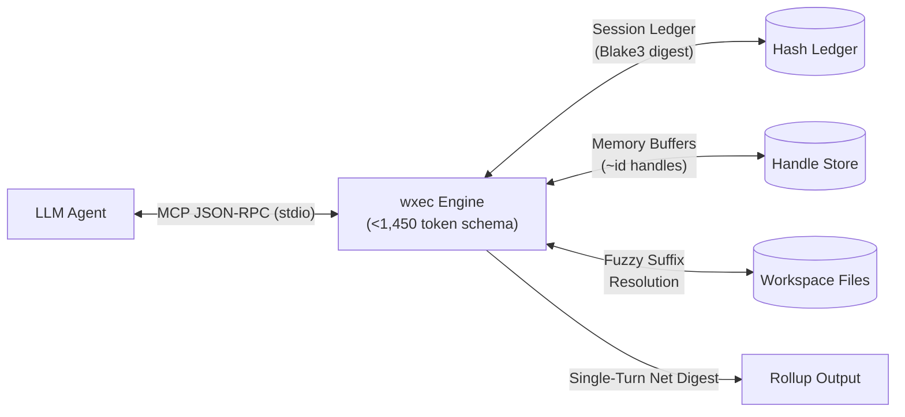

# wxec

[](https://github.com/kaeinmotion/wxec/actions)
[](https://github.com/kaeinmotion/wxec/releases/latest)
[](https://opensource.org/licenses/MIT)
[](https://modelcontextprotocol.io)

ultra-low-token model context protocol (mcp) execution engine for AI coding agents. routes agent operations through structured primitives, session hash ledgers, and atomic memory handles (`~id`) to eliminate prompt bloat and shell noise.

---

## core architectural capabilities

- **zero-token handle referencing (`~id`)**: truncated logs and diffs are cached in session memory. downstream tools (`replace`, `edit`, `expand`) accept `~id` or `@~id` directly, moving large code blocks with zero JSON-RPC re-transmission.
- **suffix & fuzzy path resolution**: relative paths missing parent directory prefixes (e.g. `path: "fs.rs"` or `path: "src/replace.rs"`) auto-resolve to unique workspace matches on turn 1, preventing failed search retry loops.
- **single-turn batch rollup**: `batch` chains operations and collapses multi-step mutations into a single-line Net Digest (`batch rollup: N ok (+ins -del, N passed)`), preserving $>80\%$ context window budget.
- **ultra-low-token search (`files_only`)**: broad codebase sweeps short-circuit line scanning and return only unique matching paths.
- **targeted test filtering**: `check` selectively passes test filters (`filter: "<test>"`) exclusively to test runners, finishing in $<1.5$s.
- **strict schema budgeting**: all 9 tool schemas stay strictly under ~1,450 tokens.



---

## documentation

all architectural specifications, benchmarks, tool catalogs, and client setups live in [`docs/`](docs/):

| document | contents |
| :--- | :--- |
| **[docs/guide.md](docs/guide.md)** | architecture, benchmarks (-83.7% tokens), 1-click client setups, and batching workflows |
| **[docs/tools.md](docs/tools.md)** | complete mcp tool specifications, schemas, and operational boundaries |
| **[docs/security.md](docs/security.md)** | threat model, path jailing, credential redaction, and permission tiers |
| **[docs/wire-format-v0.2.md](docs/wire-format-v0.2.md)** | wire protocol serialization, handle store (`~id`), and token estimators |

---

## quick start

**install binary (macos & linux):**
```sh
curl -fsSL https://raw.githubusercontent.com/kaeinmotion/wxec/main/scripts/install.sh | sh
```

**from source:**
```sh
cargo install --git https://github.com/kaeinmotion/wxec.git wxec-cli
```

**via npm wrapper:**
```sh
npx -y @kae/wxec
```

**via smithery:**
```sh
npx -y @smithery/cli install kaeinmotion/wxec --client claude
```

---

## license

mit.
