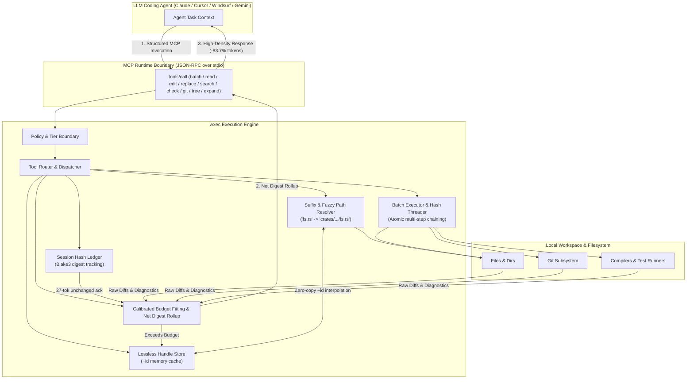
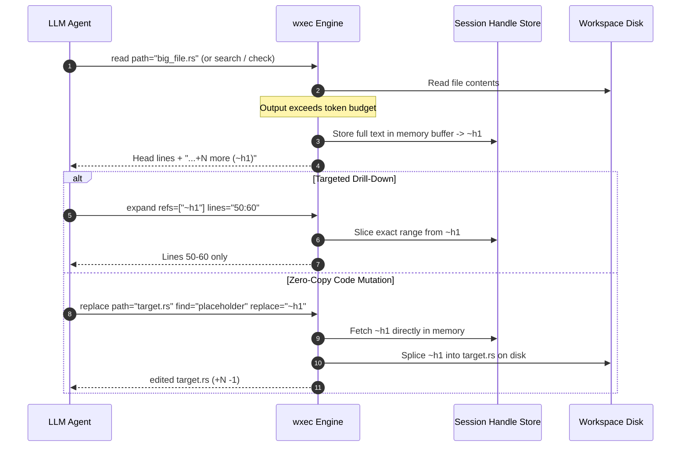

# wxec: the definitive guide

comprehensive architectural specification, operator manual, and client integration reference for wxec mcp.

---

### **table of contents**

- [chapter 1: architecture & system design](#chapter-1-architecture--system-design)
- [chapter 2: empirical benchmarks & cost reduction](#chapter-2-empirical-benchmarks--cost-reduction)
- [chapter 3: mcp tool catalog & interfaces](#chapter-3-mcp-tool-catalog--interfaces)
- [chapter 4: client configurations & deployment](#chapter-4-client-configurations--deployment)
- [chapter 5: workspace runtime configuration (.wxec.toml)](#chapter-5-workspace-runtime-configuration-wxectoml)
- [chapter 6: 1-turn atomic batching workflows](#chapter-6-1-turn-atomic-batching-workflows)
- [chapter 7: enterprise security, jailing & permission tiers](#chapter-7-enterprise-security-jailing--permission-tiers)

---
---

### **chapter 1: architecture & system design**

wxec operates as an in-process, protocol-level mediator between large language models and software workspaces with an uncompromising **mcp only** architecture. our core mission is **super low token usage** while seamlessly powering legacy environments (bash, zsh, tmux, ci/cd pipelines, remote headless shells) without incurring raw terminal token waste.

traditional terminal agents consume excessive tokens parsing unstructured terminal stdout/stderr, shell prompts, and ANSI escapes. wxec solves this through five core subsystems:

- **mcp-only runtime boundary**: enforces structured json-rpc over stdio, eliminating shell noise and preventing agents from falling into token-draining direct cli loops.
- **session hash ledger**: maintains a stateful blake3 cryptographic digest of all file reads across agent turns. unchanged files return an instant 27-token acknowledgment rather than re-emitting file contents.
- **lossless handle store (`~id`)**: large outputs (diffs, compilation logs, directory trees) exceeding context budget thresholds are offloaded to atomic cache handles. models receive high-density summaries and expand targeted line offsets on demand via `expand`.
- **simd workspace cache**: in-memory directory index utilizing vectorized substring pre-matching (`memmem`), executing workspace-wide searches in sub-millisecond durations.
- **calibrated budget fitting**: prioritizes actionable diagnostics, compilation errors, and exact line references while compressing ambient noise into handles.

#### **system architecture**



#### **handle lifecycle & zero-copy interpolation**



measured across real-world developer workflows using the standard `cl100k_base` tokenizer:

| task | raw shell | rtk (0.37.2) | wxec mcp | token savings vs raw |
| :--- | :---: | :---: | :---: | :---: |
| `git status` | 86 tok | 22 tok | **16 tok** | -81.4% |
| `git diff` | 1,661 tok | 1,319 tok | **874 tok** | -47.4% |
| `read file` (480 lines) | 3,422 tok | 3,422 tok | **27 tok** | -99.2% |
| `search / grep` | 567 tok | 459 tok | **11 tok** | -98.1% |
| `test execution` | 356 tok | 99 tok | **10 tok** | -97.2% |
| **total benchmark tokens** | **6,257 tok** | **5,381 tok** | **1,018 tok** | **-83.7%** |

---

### **chapter 3: mcp tool catalog & interfaces**

| tool | tier | purpose | key parameters |
| :--- | :---: | :--- | :--- |
| `read` | read_only | compact file & symbol inspector | `path`, `lines` (`"1:50"` or `"1-50"`), `force` |
| `edit` | write_workspace | surgical exact code editor | `path`, `find`/`target`, `replace`/`replacement` |
| `search` | read_only | simd-accelerated workspace search | `pattern`/`query`, `path`, `mode` (`text`/`regex`/`symbol`) |
| `replace` | write_workspace | global multi-file pattern replacement | `find`, `replace`, `path`, `glob`, `dry_run` |
| `tree` | read_only | structured directory hierarchy | `path`, `depth`, `sizes`, `dirs_only` |
| `check` | execute | project compiler and test checker | `kind` (`test`, `build`, `lint`, `type`, `all`) |
| `git` | git_write | complete git lifecycle | `op` (`status`, `add`, `diff`, `commit`, `push`, `log`) |
| `batch` | per-call | bundle up to 16 calls in 1 turn | `calls: [{"tool": "...", "args": {...}}]` |
| `expand` | read_only | retrieve full text from handle | `id` (e.g. `"~h123"`), `lines`, `grep` |
| `run` | execute | structured executable runner | `argv`/`cmd`, `cwd`, `timeout_ms` |
| `sh` | execute | shell execution fallback | `command`, `cwd`, `timeout_ms` |

---

### **chapter 4: client configurations & deployment**

#### **cursor** (`.cursor/mcp.json`)
```json
{
  "mcpServers": {
    "wxec": {
      "command": "wxec",
      "args": ["--tier", "git_write"]
    }
  }
}
```

#### **opencode** (`opencode.json` or `~/.config/opencode/opencode.json`)
```json
{
  "$schema": "https://opencode.ai/config.json",
  "mcp": {
    "wxec": {
      "type": "local",
      "command": ["wxec", "--tier", "git_write"],
      "enabled": true
    }
  }
}
```

#### **claude desktop** (`claude_desktop_config.json`)
```json
{
  "mcpServers": {
    "wxec": {
      "command": "wxec",
      "args": ["--root", "/path/to/your/workspace", "--tier", "git_write"]
    }
  }
}
```

#### **claude code cli**
```sh
claude mcp add wxec -- wxec --tier git_write
```

#### **cline / roo code** (`cline_mcp_settings.json`)
```json
{
  "mcpServers": {
    "wxec": {
      "command": "wxec",
      "args": ["--tier", "git_write"],
      "disabled": false,
      "autoApprove": ["read", "search", "tree", "expand"]
    }
  }
}
```

#### **docker (containerized execution)**
```json
{
  "mcpServers": {
    "wxec": {
      "command": "docker",
      "args": ["run", "-i", "--rm", "-v", "${workspaceFolder}:/workspace", "ghcr.io/kaeinmotion/wxec"]
    }
  }
}
```

---

### **chapter 5: workspace runtime configuration (.wxec.toml)**

optional `.wxec.toml` or `wxec.toml` placed in your workspace root:

```toml
[session]
default_tier = "git_write"
ledger_ttl_secs = 86400

[handles]
ttl_secs = 86400
max_bytes = 104857600

[exec]
allow_shell = true
timeout_ms = 120000

[output]
verbosity = "minimal"
```

---

### **chapter 6: 1-turn atomic batching workflows**

bundle multi-step operations into a single round-trip turn to eliminate network serialization latency:

```json
{
  "calls": [
    {
      "tool": "edit",
      "args": {
        "path": "crates/wxec-core/src/lib.rs",
        "find": "let max = 10;",
        "replace": "let max = 20;"
      }
    },
    {
      "tool": "check",
      "args": {"kind": "test"}
    },
    {
      "tool": "git",
      "args": {"op": "status"}
    }
  ]
}
```

when `stop_on_error: true` is passed, execution halts immediately after the first failing step and reports remaining calls as skipped.

---

### **chapter 7: enterprise security, jailing & permission tiers**

- **workspace jailing**: all paths are strictly confined inside workspace root; traversal escapes (`../`) are rejected.
- **secret redaction**: credentials, api keys, tokens, and private keys are scrubbed before reaching wire output via high-speed regexset matching.
- **permission tiers**:

| tier | level | authorized tools |
| :--- | :---: | :--- |
| `read_only` | 0 | `tree`, `read`, `search`, `expand`, `git` (status/diff/log) |
| `write_workspace` | 1 | `edit`, `replace` |
| `execute` | 2 | `run`, `check`, `sh` |
| `git_write` | 3 | `git add`, `git commit`, `git push` |
